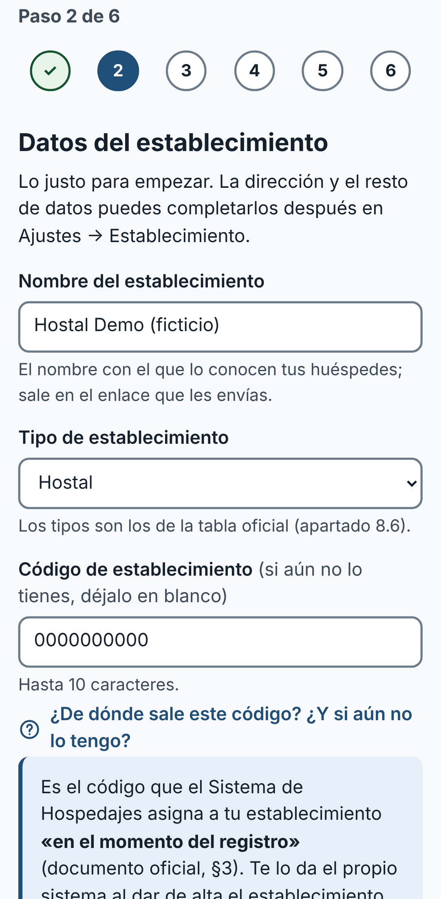
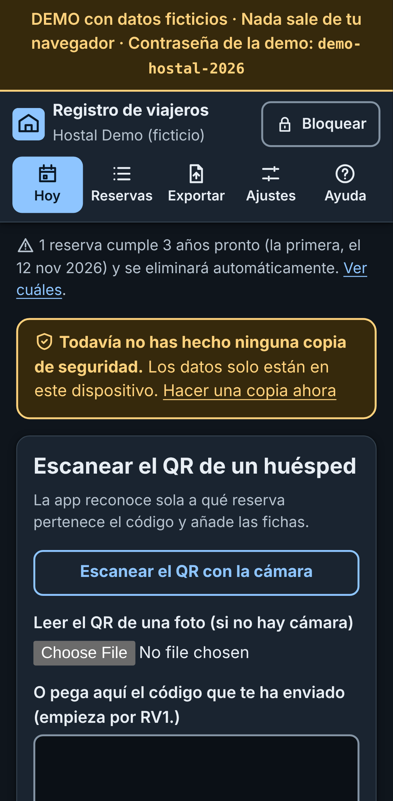
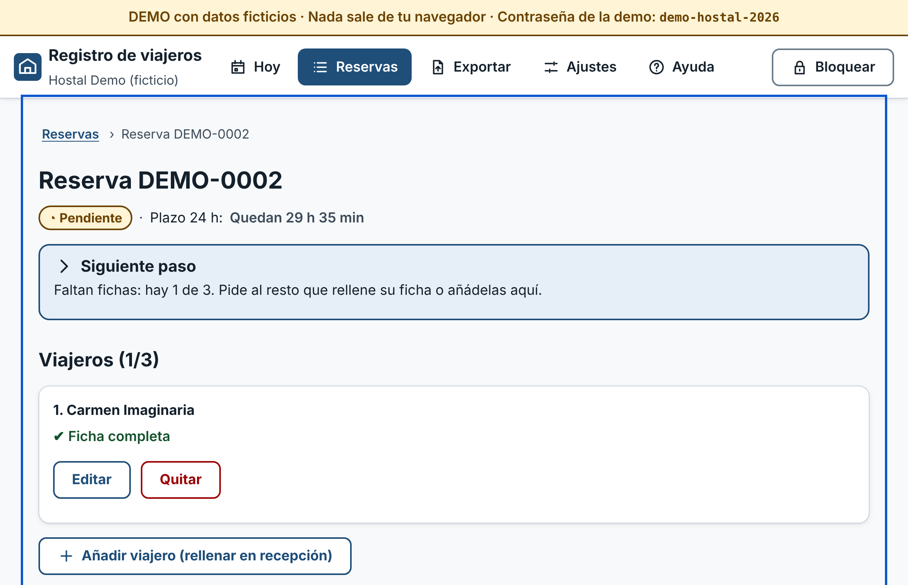
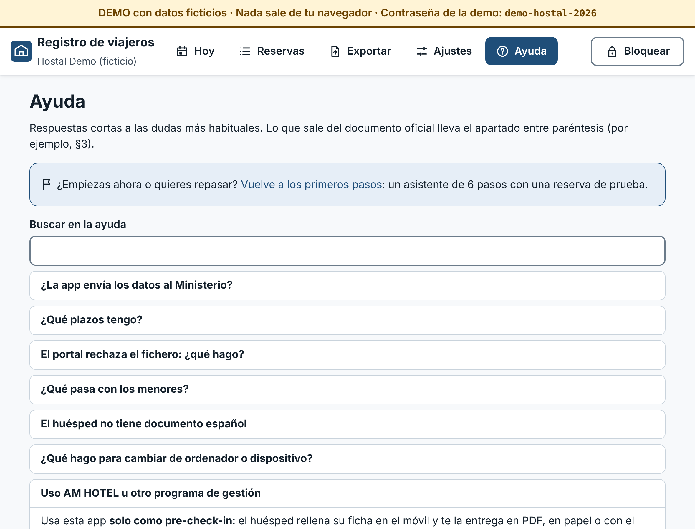
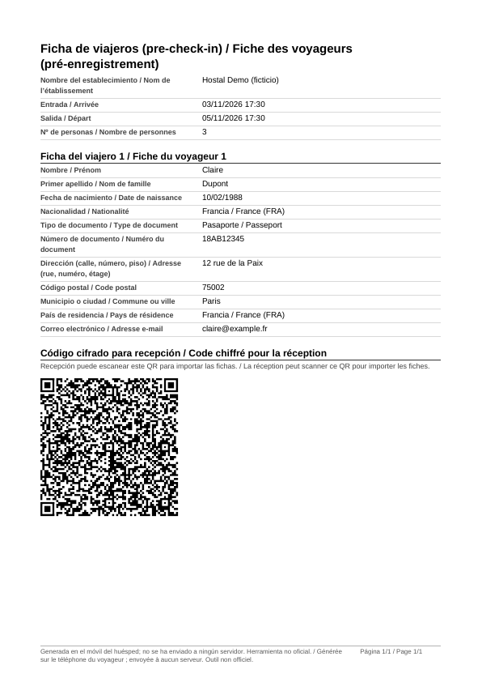

# Registro de viajeros

Registro de viajeros **libre, sencillo y local-first** para alojamientos pequeños en España (pensiones, pisos turísticos, casas rurales, hostales…). Prepara y valida el fichero de **alta masiva** de SES.Hospedajes sin servidor, sin cuentas y sin que nadie más tenga tus datos.

> ## ⚠️ Aviso importante
> **Esta es una herramienta no oficial.** No está afiliada ni respaldada por el Ministerio del Interior. **No envía nada al Ministerio**: genera y valida un fichero que **tú debes subir** al portal SES.Hospedajes. **El establecimiento sigue siendo el único responsable** de comunicar los datos dentro de plazo y de que sean correctos. Lee la sección [Qué está validado y qué no](#qué-está-validado-contra-el-documento-oficial-y-qué-no) antes de usarla en producción, y contrasta siempre el primer fichero con la plantilla real del portal.


## Qué problema resuelve y para quién

Desde el 2-dic-2024 (Real Decreto 933/2021) los alojamientos deben comunicar al Ministerio del Interior los datos de cada contrato/reserva y de cada viajero **en 24 horas**, y conservarlos **3 años**. Los alojamientos pequeños acaban rellenándolo a mano o pagando herramientas comerciales que se quedan con los datos de sus huéspedes.

**Para quién:** quien lleva la recepción de un alojamiento pequeño y quiere (1) que los huéspedes rellenen sus datos desde el móvil, (2) saber de un vistazo qué partes están completos y cuáles vencen, y (3) generar el fichero oficial sin pasar los datos por un tercero. Ver [¿Para quién es?](#para-quién-es).

## ¿Para quién es?

| | **Alojamiento SIN programa de gestión** | **Alojamiento CON programa de gestión (PMS)** |
|---|---|---|
| Ejemplos | Pensiones, pisos y apartamentos turísticos, casas rurales, casas de huéspedes | Hostales y hoteles que ya usan un programa de recepción |
| Problema | Rellenar a mano en el portal, o pagar una herramienta que se queda con los datos | El programa ya registra (y a menudo comunica) los partes, pero teclear los datos del huésped en el mostrador lleva tiempo |
| Para qué sirve la app | **Todo el circuito:** reservas, fichas desde el móvil del huésped, revisión, aviso de 24 h y **fichero XML validado** para subir a SES.Hospedajes | **Solo pre-check-in:** el huésped rellena su ficha en su móvil (6 idiomas) y la entrega como **PDF, papel o QR**; recepción la lee y la pasa a su programa |
| Lo que NO debes hacer | — | **No exportes ni subas también el XML** si tu programa ya comunica los partes: el mismo parte se comunicaría dos veces. Pregunta a tu proveedor qué comunica exactamente |

La ficha que descarga el huésped lleva cada dato con su etiqueta **en español y en su idioma** (p. ej. «Tipo de documento / Ausweisart: Pasaporte / Reisepass»), así que el personal la puede transcribir aunque no hable alemán. En los dos casos, el huésped no necesita instalar nada ni crear cuentas.

## Demo

**https://danielbuitragoh.github.io/registro-viajeros/** — datos 100 % ficticios; todo ocurre en tu navegador. Contraseña de la demo: `demo-hostal-2026`.

**Presentación para dueños de alojamientos** (qué hace, qué no hace, privacidad y cómo empezar en 3 pasos): **https://danielbuitragoh.github.io/registro-viajeros/presentacion/** · [English](https://danielbuitragoh.github.io/registro-viajeros/presentacion/en/). Es una página estática, sin JavaScript, que también funciona sin conexión.

> La demo se despliega con GitHub Actions al fusionar en `main` (ver `.github/workflows/pages.yml`). Hace falta una única vez activar *Settings → Pages → Source: GitHub Actions* en el repositorio.

<p>
  
  
  
</p>
<p>
  
  
</p>
<p>
  
  
</p>

*Capturas reales de la demo (datos ficticios), generadas con `node scripts/capturas.mjs`: asistente de primeros pasos · huésped en francés con la guía del documento · «Hoy» en modo oscuro con el escáner · ficha de reserva con el siguiente paso · Ayuda · exportación validada · ficha en PDF generada en el móvil.*

## Guía de 5 minutos para el dueño de un alojamiento

Lo justo para empezar hoy. Necesitas un ordenador o una tablet en recepción con Chrome, Edge, Firefox o Safari actualizados. **No hace falta leer nada más: al abrir la app por primera vez, un asistente de 6 pasos te guía** (con barra de progreso, *Atrás* y *Saltar*; se retoma en *Ajustes → Primeros pasos*):

1. **Contraseña del establecimiento**, y qué significa perderla: nadie puede recuperarla; la única salida es una copia de seguridad.
2. **Datos del establecimiento**: nombre, tipo y **código de establecimiento** (te lo asigna SES.Hospedajes al registrarlo). ¿Aún no lo tienes? Déjalo en blanco y sigue: la app te explica qué puedes hacer sin él.
3. **Una reserva de prueba** (marcada «Prueba», para practicar sin tocar datos reales).
4. **Enviar el enlace a un huésped**: ábrelo en tu propio móvil para ver lo que verá el huésped (o añade un viajero de ejemplo ficticio).
5. **Generar el primer fichero** (de prueba: la app te recuerda que no lo subas).
6. **Copia de seguridad** y cada cuánto quieres que «Hoy» te la recuerde. Al terminar, la reserva de prueba se borra.

Después, el día a día está en **Hoy**: *Nueva reserva*, *Escanear el QR de un huésped* (la app reconoce sola de qué reserva es) y *Exportar los partes listos*. Cada reserva dice cuál es su **siguiente paso**. Y si dudas, **Ayuda** tiene las preguntas frecuentes (plazos, el portal rechaza el fichero, menores, huésped sin documento español, cambiar de ordenador, AM HOTEL u otros programas…).

Si quieres, **instálala** (icono de instalar en la barra de direcciones de Chrome/Edge, o «Añadir a pantalla de inicio» en el móvil): se abre como una app y **funciona sin conexión**.

> ¿Tienes programa de gestión (AM HOTEL u otro)? Usa la app **solo como pre-check-in** (el huésped rellena su ficha y tú pasas los datos a tu programa) y **no subas también el XML** si tu programa ya comunica los partes: se comunicarían dos veces.

## Cómo usarlo, paso a paso (detalle)

1. **Primer uso** (en el ordenador/tablet de recepción): abre la app, crea la **contraseña del establecimiento** y guárdala en un sitio seguro. No se puede recuperar.
2. **Ajustes → Establecimiento** (o el paso 2 del asistente): nombre, tipo (Hostal…) y **código de establecimiento** (lo asigna el Sistema de Hospedajes al registrarte; junto al campo, «¿De dónde sale este código? ¿Y si aún no lo tengo?»).
3. **Nueva reserva:** referencia, fechas de entrada/salida previstas, nº de personas, habitación, canal y forma de pago.
4. **Que el huésped rellene su ficha:** en la reserva pulsa *Crear enlace para el huésped* y envíale el enlace (o enséñale el QR). Desde su móvil, en **español, inglés, francés, alemán, italiano o portugués**, rellena una ficha por viajero y obtiene un **código cifrado** (QR, texto o archivo). En recepción pulsas *Escanear el QR de un huésped* en **Hoy** (reconoce sola la reserva) o *Escanear el QR con la cámara* en la propia reserva (o lees el QR de una foto, o pegas el código) y las fichas se importan. Si el alojamiento lo pide, el huésped puede además **descargar su ficha en PDF o imprimirla** (pre-check-in). Si prefieres, rellénalas tú en recepción.
5. **Revisa la reserva:** arriba, el **siguiente paso**; la sección *Revisión del parte* te dice, con mensajes claros y un botón *Corregir*, qué falta (p. ej. «la letra de control debería ser Z», o el código INE del municipio, que el huésped no suele conocer).
6. **Lista del día (Hoy):** una tarjeta por reserva con su estado (*pendiente / completo / exportado*), plazo y siguiente paso, y **aviso de 24 h** con enlace a cada reserva vencida o que vence en menos de 6 h.
7. **Exportar:** elige el tipo de fichero (*partes de viajeros* o *reservas de hospedaje*), marca las reservas, pulsa *Validar y generar fichero*. Solo se puede descargar si supera la validación.
8. **Súbelo tú al portal SES.Hospedajes.** Hasta que no lo subas, la comunicación **no está hecha**, aunque la app lo marque como «exportado».
9. **Copias de seguridad:** *Ajustes → Copia de seguridad* (descarga un fichero cifrado). «Hoy» te avisa si no has hecho ninguna o si la última es más antigua que la frecuencia elegida (semanal por defecto): los datos viven solo en ese dispositivo.

## Pensada para cualquiera: asistente, guía y diseño

El análisis de los recorridos (primer uso, recepción, huésped, exportar, copias, purga), sus fricciones y el plan está en [`docs/ux.md`](docs/ux.md). En resumen:

- **Asistente de primeros pasos** (6 pasos, progreso, *Atrás*, *Saltar* y retomar desde Ajustes) con una reserva de prueba.
- **Navegación por frecuencia de uso:** Hoy → Reservas → Exportar → Ajustes → Ayuda, con **icono y texto**; **migas de pan** en reservas y en las subpáginas de Ajustes; atajos grandes en «Hoy».
- **Guía contextual:** «¿Qué es…?» desplegable junto a cada campo difícil (tipo de documento, número de soporte con **ilustración esquemática**, código INE con un ejemplo de la muestra ficticia, código de establecimiento, segundo apellido, teléfono extranjero, menores, 24 h, forma de pago); **estados vacíos** que dicen qué hacer; página **Ayuda** con 14 preguntas frecuentes y buscador; preguntas frecuentes también para el huésped.
- **Sistema de diseño** único para la app y la presentación (`src/diseno/tokens.css`: color, tipografía, espaciado, forma y tamaño táctil), **modo oscuro** (automático o elegido en *Ajustes → Apariencia*), contraste AA comprobado numéricamente en los dos temas y con axe en navegador real, objetivos táctiles de 48–56 px, estados con icono y texto.
- **Idiomas:** la recepción está en español; todo lo que ve el **huésped** (formulario, guía de cada campo, tipos de documento y preguntas frecuentes) está en los 6 idiomas. **Las traducciones al francés, alemán, italiano y portugués necesitan revisión de una persona nativa**, también los 44 textos nuevos de la guía y la ayuda de esta versión.

## Tipos de documento admitidos (y por qué)

Exactamente los de la **tabla 8.5 «Tipos de documento»** de [`docs/oficial/Instrucciones.pdf`](docs/oficial/Instrucciones.pdf), ni uno más (transcritos en `src/oficial/codigos.ts` y con sus reglas en `src/oficial/documentos.ts`):

| Código | Tabla 8.5 | Validación | Reglas del §3 (partes de viajeros) |
|---|---|---|---|
| `NIF` | NIF - Número de Identificación Fiscal | DNI: 8 cifras + **letra de control** (tabla completa de los 23 restos). K, L, M: formato, sin control (aviso) | Segundo apellido y número de soporte obligatorios |
| `NIE` | NIE - Número de Identidad de Extranjero | X/Y/Z + 7 cifras + **letra de control** | Número de soporte obligatorio |
| `PAS` | Número de pasaporte | 5–15 letras o cifras; patrón habitual por país **solo como aviso** (P10) | — |
| `OTRO` | Otro | Hasta 15 caracteres (String(15)) | — |

Además, el §3 dice que el número «deberá corresponder al tipo de documento»: si con *pasaporte* u *otro* se escribe un DNI o NIE con su letra correcta, la app **avisa** (no bloquea) para que se elija el tipo bueno. El documento (tipo y número) es obligatorio para mayores de edad (§3). **No hay código propio para el carné de identidad de otro país** (p. ej. de la UE), permisos de residencia ni carnés de conducir: la guía del huésped propone **OTRO**, el único genérico de la tabla, y queda como pendiente **P16**. Cada tipo tiene su ayuda para el huésped, en los 6 idiomas, con un ejemplo ficticio y válido (`12345678Z`, `X1234567L`) donde el documento fija el formato.

## Códigos de municipio INE (autocompletado sin red)

En recepción (y, opcionalmente, en el formulario del huésped y en *Ajustes → Establecimiento*), el campo **Nombre del municipio** sugiere municipios mientras escribes; al elegir uno, el **código INE se rellena solo**. Funciona sin conexión: la relación va dentro de la app. Busca sin tildes, con el artículo delante («Las Rozas…» aunque el INE escriba «Rozas…, Las») y por cualquier parte de un nombre bilingüe; los municipios de la provincia del código postal salen primero (solo ordena, no valida).

**De dónde salen los datos: SOLO del fichero oficial del INE** «Relación de municipios y sus códigos por provincias». No se descargan ni se teclean códigos de ninguna otra fuente. **Este repositorio todavía no incluye ese fichero**, así que hoy:

- la **app normal** no trae relación y el código se escribe a mano (lo indica junto al campo);
- la **demo** usa una **muestra FICTICIA** (provincias 98 y 99, que no existen; ver `tests/fixtures/ine/LEEME-FICTICIO.md`) para que se vea cómo funciona. Los domicilios de la demo usan esos municipios inventados.

### Cómo añadir el fichero oficial (una vez al año)

1. Descarga de la web del INE la «Relación de municipios y sus códigos por provincias» más reciente (es la que tiene fecha a 1 de enero). Si viene en `.xls` antiguo, ábrelo con Excel o LibreOffice y guárdalo como `.xlsx` **sin tocar nada más**.
2. Cópialo **tal cual** en `docs/oficial/ine/` (p. ej. `docs/oficial/ine/diccionario26.xlsx`).
3. Ejecuta (Node 22.18 o posterior):
   ```bash
   npm run ine:importar -- docs/oficial/ine/diccionario26.xlsx
   ```
   Si el título del fichero no trae la fecha, añade `--fecha 2026-01-01` (la que figure en la web del INE).
4. Se crea `src/oficial/ine/municipios-AAAA-MM-DD.json` y el script lista las **altas, bajas (p. ej. fusiones) y cambios de nombre** respecto a la relación anterior. Ejecuta `npm test` y haz commit del fichero del INE **y** del JSON juntos.

Qué comprueba el importador: que estén las columnas `CPRO`, `CMUN` y `NOMBRE` (en cualquier fila y orden), que cada código tenga sus cifras, que no haya códigos repetidos y que la fecha sea coherente. **Si algo no cuadra, se detiene y lo explica; nunca adivina.** El código de 5 dígitos es `CPRO` (2) + `CMUN` (3); el dígito de control `DC` no se usa (ver P15). Una prueba de guardia comprueba que **cada JSON de `src/oficial/ine/` se regenera idéntico desde su fichero en `docs/oficial/ine/` (misma huella SHA-256)** y que todo fichero oficial tiene su JSON: así nadie puede colar códigos que no salgan del INE. Si hay relación oficial, la muestra ficticia no se usa nunca, ni siquiera en la demo.

> **Aviso honesto:** el lector se ha probado con muestras ficticias que imitan la forma de la relación (fila de título con la fecha, cabecera `CODAUTO · CPRO · CMUN · DC · NOMBRE`), escritas con otro programa (openpyxl) y en CSV Windows-1252. **No se ha probado con el fichero real del INE**: la primera vez, revisa el resumen que imprime el script (nº de municipios, fecha) antes de hacer commit.

### Municipios que cambian de código (fusiones, altas) según la fecha de la relación

La relación es una foto a una fecha. La app usa la **más reciente** que tenga y lo dice junto al campo («relación del INE a 01/01/2026»). Para un código escrito o importado de una ficha, la revisión del parte da **avisos, nunca errores** (un aviso no bloquea la exportación):

- **no figura** en la relación → puede ser un error… o un municipio dado de alta después de esa fecha;
- **figuraba en una relación anterior y ya no** (si conservas también la del año anterior en `docs/oficial/ine/` y su JSON) → probablemente una fusión: busca el municipio actual;
- **el nombre escrito no es el de ese código** → revisa uno de los dos.

Conserva al menos la relación del año anterior para que la app detecte las bajas. Cada relación es un trozo aparte (del orden de 150 kB sin comprimir, estimado para unos 8 100 municipios) que se carga solo al usarlo y que el *service worker* guarda para usarlo sin conexión.

## Decisiones de diseño

- **App instalable que funciona sin conexión (PWA).** Tras la primera carga, un *service worker* guarda en el dispositivo todo lo necesario (código, estilos, páginas, iconos y la relación de municipios), así que recepción sigue funcionando aunque se caiga internet. No hay caché de nada externo. Cuando se publica una versión nueva, **no se recarga por sorpresa**: aparece un aviso «Hay una nueva versión de la app» con *Actualizar ahora* / *Más tarde* (en recepción recuerda que después pedirá la contraseña; en el móvil del huésped sale en su idioma). La app comprueba si hay versión nueva al abrirse y cada hora, pidiendo solo su propio `sw.js`. Solo la raíz es la app: cualquier otra página del sitio (la presentación, con o sin parámetros o barra final) se sirve con su propio HTML, también sin conexión. Quien tuviera el *service worker* anterior al PR #3 recibe el nuevo automáticamente una sola vez (antes se quedaba en espera para siempre y veía la app en `/presentacion/`).
- **Local-first y sin servidor.** No hay backend, cuentas, analítica ni llamadas externas (la política de seguridad del navegador, CSP, solo permite recursos propios). Es la única forma de que el hostal no dependa de —ni entregue sus datos a— un tercero. Coste: los datos viven en un dispositivo, así que importa la copia de seguridad.
- **Cifrado en reposo.** Todo en IndexedDB, cifrado con **AES-256-GCM**; la clave se deriva de la contraseña del establecimiento con **PBKDF2-SHA256 (600 000 iteraciones)** y no es exportable. Cada registro se cifra ligado a su identificador (AAD): un registro copiado a otro id se detecta. Se bloquea solo tras 15 min sin actividad.
- **¿Cómo llega la ficha del móvil del huésped a recepción sin servidor?** El enlace/QR va en el *fragmento* de la URL (`#…`, que no viaja a ningún servidor) y contiene solo datos de la reserva (nada personal) y una clave aleatoria de 256 bits. El huésped rellena la ficha en su móvil y esta se cifra con esa clave en un **código de envío** ligado a la reserva, que entrega por texto, QR o archivo. Recepción lo importa. Alternativas descartadas: un servidor de paso (rompe el principio sin servidor) o WebRTC (necesita señalización).
- **Lector de QR sin red.** Si el navegador tiene `BarcodeDetector` con QR (Chrome/Edge en Android, macOS, ChromeOS…) se usa; si no, [jsQR](https://github.com/cozmo/jsQR) empaquetado en la propia app (JavaScript puro, sin dependencias ni llamadas a internet). La cámara se apaga al leer, al cancelar o al salir. Si se escanea por error el QR del *enlace*, la app lo explica.
- **Ficha del huésped en PDF sin servidor.** El PDF se genera en el móvil con un escritor mínimo propio (PDF 1.4, fuentes estándar, QR vectorial); no hace falta ninguna librería. Si un nombre usa un alfabeto que esas fuentes no tienen (cirílico, chino…), se avisa y se ofrece *Imprimir ficha*, que usa el navegador y admite cualquier alfabeto. El QR del PDF se ha comprobado leyéndolo de la página rasterizada.
- **Idiomas del huésped:** español, inglés, francés, alemán, italiano y portugués. Solo se traducen los textos visibles; los códigos que se exportan son siempre los de las tablas oficiales. Las pruebas comprueban que ningún idioma pierde ni añade claves. *Traducciones hechas con ayuda de IA: conviene que las revise una persona nativa.*
- **El huésped no queda bloqueado por datos que no puede saber** (código INE del municipio): recepción los completa.
- **Dos barreras de validación en la exportación:** (1) reglas del modelo y (2) un validador **independiente** que reparsea el XML ya generado contra un esquema transcrito del PDF. Si el constructor tuviera un fallo, no llegaría a descargarse.
- **Purga a los 3 años**, con aviso 30 días antes. Como todo está cifrado, la purga se ejecuta al desbloquear la app.
- **Accesibilidad (objetivo WCAG 2.2 AA):** etiquetas visibles, errores asociados a su campo y resumen de errores enfocable, `autocomplete`, objetivos táctiles ≥ 48 px, estados con texto e icono (no solo color), no pedir dos veces el mismo dato (copiar la dirección del viajero 1), contraseña sin bloqueo de pegado, `lang` correcto por idioma, contraste verificado numéricamente en tests. *Verificado con axe y con pruebas; no sustituye una auditoría con usuarios y lectores de pantalla reales.*

## Qué está validado contra el documento oficial y qué no

Fuente única de verdad: [`docs/oficial/Instrucciones.pdf`](docs/oficial/Instrucciones.pdf) («Alta masiva de comunicaciones Hospedajes», v1.1.0, 08-01-2024). Mi lectura completa, campo por campo, está en [`docs/oficial/NOTAS.md`](docs/oficial/NOTAS.md). En el código, cada punto pendiente lleva el marcador `PENDIENTE-OFICIAL`.

**Validado contra el documento (con pruebas):** estructura `peticion > solicitud > comunicacion` y orden de elementos de las figuras 1 y 2 · un solo tipo de comunicación por fichero · campos, longitudes máximas y obligatoriedades (incluidas las condicionales: apellido2 con NIF, soporte con NIF/NIE, documento si es mayor de edad, «teléfono, teléfono2 o correo», parentesco si hay un menor, municipio INE si el país es España y nombre si no) · formatos de fecha (`AAAA-MM-DD`, `AAAA-MM-DDThh:mm:ss`) · bloques `direccion` y `pago` · tablas de códigos 8.3–8.7 (parentesco, sexo, documento, establecimiento, pago) y roles TI/VI · DNI y NIE con su letra de control (tabla completa de los 23 restos) y CIF.

**Pendiente / no verificado (no inventado):**

| # | Pendiente | Qué hace la app |
|---|-----------|-----------------|
| P1 | El PDF no incluye XSD ni espacio de nombres ni declaración XML | Emite `<?xml … UTF-8?>` y elementos sin namespace. **Contrastar con la plantilla real del portal** |
| P2 | La tabla del §3 dice `documento`; la figura 1 y el §4 dicen `numeroDocumento` | Usa `numeroDocumento` |
| P3 | Formato del campo `internet` (Booleano) sin definir | No lo emite (es opcional) |
| P4 | No hay tabla de municipios INE ni de países | INE: formato (5 dígitos) y, si se añade el fichero oficial del INE, autocompletado y avisos ([ver arriba](#códigos-de-municipio-ine-autocompletado-sin-red)). Países: lista ISO 3166-1 (norma citada por el PDF), revisar vigencia |
| P5 | El PDF no tiene «código de arrendador» | Dato interno opcional, **no se exporta** |
| P6 | «Mayor de edad» sin definir | 18 años a la fecha de entrada |
| P7 | `parentesco` es un solo campo por persona sin decir a qué menor se refiere | Se informa en el adulto acompañante; con varios menores y parentescos distintos, aviso |
| P8 | No dice si el titular que se aloja se repite (TI + VI) | Partes: solo VI. Reservas: un TI + los VI |
| P9 | Formato de teléfono/correo no definido | Validación permisiva |
| P10 | Formato exacto del soporte y de pasaportes por país | Soporte alfanumérico ≤ 9. Pasaporte por país **orientativo** (aviso, nunca bloquea) |
| P12 | Cómputo de las 24 h y de los 3 años (viene del RD, no del PDF) | 24 h desde la entrada prevista; 3 años desde la salida. Confirmar con asesoría |
| P14 | Subida al portal y errores que devuelve el sistema | Fuera de alcance: la subida es manual |
| P16 | La tabla 8.5 solo tiene NIF, NIE, PAS y OTRO: no hay código para el carné de identidad de otro país (UE…), permisos de residencia o carnés de conducir | Se usa **OTRO** (el único genérico). Confirmar con el portal |
| P17 | El §3 y el §4 remiten a «la tabla … en el apartado 6», pero las tablas están en el **apartado 8** | Errata: se usan las del apartado 8 |
| P15 | El PDF dice «código INE, 5 dígitos» pero no si incluye el dígito de control del INE | Usa CPRO (2) + CMUN (3), sin el dígito de control. Confirmar con el portal |

Además: el «canal de reserva» y la habitación son datos internos y no se exportan; los NIF que empiezan por K, L o M se aceptan por formato sin verificar el control; **no se ha podido probar el fichero contra el portal real**.

## Limitaciones conocidas de esta versión

- **Traducciones** (francés, alemán, italiano, portugués): hechas con ayuda de IA y comprobadas por pruebas (claves y marcadores completos), pero **necesitan revisión de una persona nativa de cada idioma**, incluidos los textos nuevos de la guía del huésped y sus preguntas frecuentes (noviembre de 2026). En noviembre de 2026 se repasaron buscando solo errores claros y se corrigieron 5 (con prueba de regresión): FR, al pie del PDF le faltaba el verbo («n’a été envoyée»); DE, «Ausweisträger» (titular) en vez del número del propio documento, un verbo separable incompleto y una frase sin sujeto; PT, «a receção completa» → «a receção preenche-o». El italiano no tenía errores claros. Lo que solo es mejorable por estilo se ha dejado como estaba.
- **Lector de QR:** la lectura real con cámara está probada en Chromium (alternativa jsQR). La vía `BarcodeDetector` (Android, macOS) solo está probada con simulaciones; conviene probarla en un móvil Android real.
- **Ayudas orientativas:** dónde suele estar el número de soporte («NÚM SOPORT», «IDESP») no sale del documento oficial (P10): se presenta como orientación, con una ilustración esquemática que no reproduce ningún documento real.
- **El selector de fichero** («Leer el QR de una foto») muestra el texto del propio navegador (en un navegador en inglés, «Choose File»).
- **PDF del huésped:** solo alfabeto latino (WinAnsi). Con otros alfabetos la app avisa y ofrece imprimir.
- **`npm audit`:** quedan avisos moderados y bajos en herramientas de desarrollo (ESLint, typescript-eslint, vite-plugin-pwa), no en el código que llega al navegador; npm solo propone bajar a versiones antiguas, así que se vigilan hasta que haya versiones corregidas.

## Privacidad y límites de seguridad

- Sin analítica, sin cookies, sin peticiones externas (comprobado en navegador real: cero peticiones a otros dominios).
- Quien tenga acceso al dispositivo **desbloqueado**, o a la contraseña, verá los datos. Si alguien copia la base de datos cifrada, solo la fuerza bruta contra la contraseña (frenada por PBKDF2) la abriría: usa una frase larga.
- El enlace del huésped contiene la clave de su código de envío: trátalo como confidencial y no lo publiques.
- La **ficha en PDF o impresa** del huésped **no va cifrada** (es para leerla): la app se lo advierte al huésped. En recepción, trátala como cualquier documento con datos personales y destrúyela cuando ya no haga falta.
- El borrado de reservas (purga o manual) se hace en este dispositivo; las copias de seguridad que hayas descargado son tu responsabilidad.
- No es una auditoría de seguridad ni asesoría jurídica (RGPD, LOPDGDD): consulta con quien corresponda.

## Desarrollo

```bash
npm ci
npm run dev        # desarrollo
npm test           # Vitest (validadores, exportador, cifrado, purga, PDF, QR, i18n, componentes)
npm run e2e        # Playwright: flujo completo en Chromium real + guardia de «cero peticiones a otros orígenes»
npm run lint       # ESLint (incluye jsx-a11y)
npm run typecheck  # tsc estricto
npm run build      # build de producción (PWA)
npm run ine:importar -- docs/oficial/ine/<fichero del INE>   # relación de municipios → src/oficial/ine/
node scripts/generar-iconos.ts   # regenera los iconos PNG de la PWA desde el diseño del SVG
node scripts/capturas.mjs http://localhost:4173   # capturas del README y de la presentación (con la demo en vite preview)
VITE_DEMO=true npm run build   # build de la demo con datos ficticios
```

Estructura: `src/diseno` (tokens del sistema de diseño y tema claro/oscuro) · `src/oficial` (tablas del PDF y reglas de los tipos de documento; `src/oficial/ine`, relaciones de municipios generadas) · `src/ine` (búsqueda y estado de códigos INE) · `scripts/` (importador del INE) · `src/validators` · `src/exportador` (módulo aislado) · `src/crypto` · `src/storage` (IndexedDB cifrado, purga, copias) · `src/huesped` (enlace, código de envío, ficha imprimible y PDF) · `src/qr` (lector) · `src/i18n` (un fichero por idioma) · `src/ui` · `e2e` (Playwright) · `docs/oficial`.

La validación de DNI, NIE y CIF vive en un paquete independiente del workspace, [`packages/documentos-es`](packages/documentos-es) (`@danielbuitragoh/documentos-es`, sin dependencias, listo para publicar en npm), que la app importa como cualquier otra dependencia.

**Pruebas end-to-end** (`e2e/`, sobre el build de producción con su CSP): (1) flujo completo: crear reserva → elegir el municipio en el autocompletado → enlace → ficha en un móvil emulado (en francés) y descarga del PDF → **recepción lee el QR con la cámara** (Chromium con una cámara falsa que muestra el QR) → parte completo → exportar → XML comprobado con `DOMParser`; (2) la demo en móvil: la lista no se mueve y cada «Abrir» abre su reserva; (3) recorrido por todas las pantallas y los 6 idiomas; (4) **PWA**: Chrome no encuentra ningún error de instalación; con un build como el de GitHub Pages (base `/registro-viajeros/`), la presentación se sirve con su HTML y nunca la app (con parámetros, sin barra final, con y sin red, y tras relevar a un SW antiguo); la app funciona **con la red cortada** tras la primera carga (recepción, municipios, exportación, enlace del huésped y presentación) y, tras **desplegar una versión nueva** en un servidor de prueba, aparece el aviso y «Actualizar ahora» la activa; (5) **presentación**: axe en navegador real (con contraste) en escritorio y móvil, sin JavaScript, menos de 40 kB sin contar imágenes, y selector de idioma; (6) **asistente completo** (contraseña → establecimiento → reserva de prueba → ficha rellenada en un móvil desde el enlace → fichero de prueba → copia → Hoy, y saltar/retomar; la pista se abre con Enter y se cierra con Espacio); (7) **huésped con documento no español** (alemana con su *Personalausweis*, en alemán: «Anderes Dokument» → OTRO, sin soporte, aviso si teclea un DNI, importación desde el atajo de Hoy y XML con `tipoDocumento` OTRO); (8) **axe con contraste en todas las pantallas** (acceso, Hoy, escáner, reserva, nueva reserva con errores, exportar, cada subpágina de Ajustes, Ayuda, primeros pasos, huésped y presentación) en **tema claro y oscuro**, en escritorio y en móvil, sin desplazamiento horizontal, y el tema elegido a mano se recuerda. Una **guardia automática** hace fallar cualquier prueba si la página intenta una petición a otro origen o el navegador informa de una violación de la CSP, y una prueba de control demuestra que la guardia sí lo detecta.

## Cómo se construyó

Construido con **Claude Code** (agente de IA de Anthropic) bajo la dirección de **Daniel Buitrago**: la **idea, la especificación y la revisión son de Daniel**; el agente leyó el documento oficial, escribió el código y las pruebas y lo verificó. Método: los validadores, el exportador, el cifrado y la purga se hicieron con **TDD** (commits `test:` primero, luego `feat:`); la interfaz se probó después, con pruebas de componentes y una prueba de humo en navegador real. Revisar un código escrito por un agente sigue siendo imprescindible: en el camino, una prueba de mutación manual detectó una laguna real (dos letras de la tabla del DNI no estaban cubiertas) que se corrigió.

## Licencia

[MIT](LICENSE) © 2026 Daniel Buitrago.

---

## English summary

**Registro de viajeros** is a free, local-first PWA for small Spanish accommodations (hostels, guest houses) that must report every guest to the Ministry of the Interior (SES.Hospedajes, Royal Decree 933/2021) within 24 hours and keep the data for 3 years. It needs **no server**: guests fill in their details on their phone (form in Spanish, English, French, German, Italian and Portuguese, WCAG 2.2 AA-oriented), producing an **encrypted code** (QR/text/file) that reception imports by **scanning the QR with the camera** (native BarcodeDetector or bundled jsQR, no network); guests can also download a readable, bilingual **PDF/printout** of their details as a pre-check-in for places that already use a property-management system; reception sees a daily list with each report's status and a 24-hour warning; and an isolated **exporter** generates the bulk-upload XML defined in the official document (`docs/oficial/Instrucciones.pdf`, v1.1.0) and validates it twice before it can be downloaded. End-to-end tests (Playwright) cover the whole flow and fail if the page makes any request to another origin. A first-use wizard (6 steps with a test booking: password, establishment, test booking, guest link, first file, backup) guides non-technical owners; navigation follows frequency of use (Today → Bookings → Export → Settings → Help) with icons and text and breadcrumbs; every tricky field has a “What is…?” hint (guest-facing hints in 6 languages), empty states say what to do next, and a Help page answers common questions. One design system (tokens) is shared by the app and the presentation page, with dark mode and AA contrast checked in both themes. Accepted identity document types are exactly those in table 8.5 of the official document (NIF, NIE, PAS, OTRO). It is an installable PWA that keeps working offline after the first load and shows a "new version available" prompt instead of reloading by surprise. Reception gets an offline municipality → INE code autocomplete, fed **only** by the official INE file once it is added to `docs/oficial/ine/` (an import script and a guard test make sure no code comes from anywhere else; until then the demo uses a clearly fictitious sample). A static, JavaScript-free presentation page for owners lives at `/presentacion/` (Spanish) and `/presentacion/en/` (English). Data lives in IndexedDB, encrypted with AES-GCM using a PBKDF2-derived key; records are auto-purged 3 years after check-out (with prior warning); encrypted backups are supported. No analytics, no external calls.

**This is NOT an official tool and does NOT submit anything to the Ministry.** You must upload the file yourself, and the establishment remains solely responsible for reporting on time. Items the official document does not specify (XML namespace, `internet` field format, INE municipality table, "arrendador" code, etc.) are **not invented**: they are marked `PENDIENTE-OFICIAL` in code and listed above. The file has not been tested against the live portal.

Built with Claude Code as the coding agent; idea, specification and review by Daniel Buitrago. MIT licensed.
