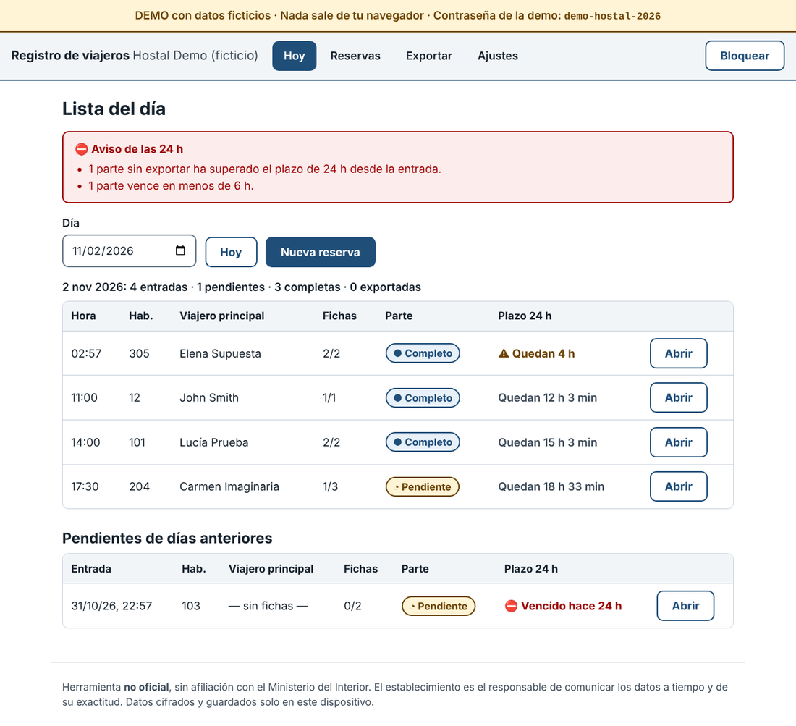
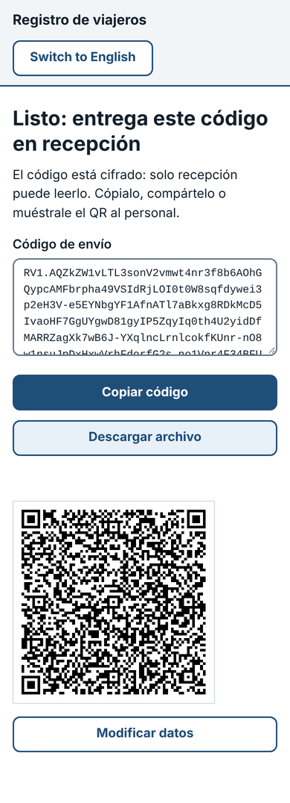
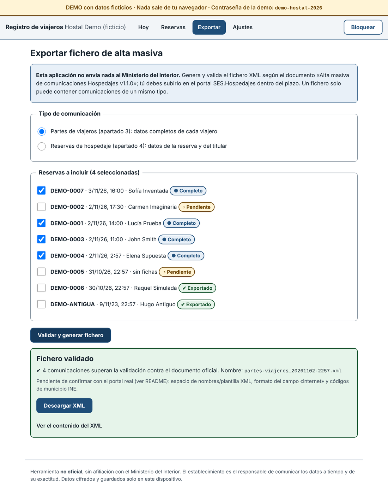

# Registro de viajeros

Registro de viajeros **libre, sencillo y local-first** para alojamientos pequeños en España (hostales, pensiones, casas de huéspedes…). Prepara y valida el fichero de **alta masiva** de SES.Hospedajes sin servidor, sin cuentas y sin que nadie más tenga tus datos.

> ## ⚠️ Aviso importante
> **Esta es una herramienta no oficial.** No está afiliada ni respaldada por el Ministerio del Interior. **No envía nada al Ministerio**: genera y valida un fichero que **tú debes subir** al portal SES.Hospedajes. **El establecimiento sigue siendo el único responsable** de comunicar los datos dentro de plazo y de que sean correctos. Lee la sección [Qué está validado y qué no](#qué-está-validado-contra-el-documento-oficial-y-qué-no) antes de usarla en producción, y contrasta siempre el primer fichero con la plantilla real del portal.



## Qué problema resuelve y para quién

Desde el 2-dic-2024 (Real Decreto 933/2021) los alojamientos deben comunicar al Ministerio del Interior los datos de cada contrato/reserva y de cada viajero **en 24 horas**, y conservarlos **3 años**. Los alojamientos pequeños acaban rellenándolo a mano o pagando herramientas comerciales que se quedan con los datos de sus huéspedes.

**Para quién:** quien lleva la recepción de un alojamiento pequeño y quiere (1) que los huéspedes rellenen sus datos desde el móvil, (2) saber de un vistazo qué partes están completos y cuáles vencen, y (3) generar el fichero oficial sin pasar los datos por un tercero.

## Demo

**https://danielbuitragoh.github.io/registro-viajeros/** — datos 100 % ficticios; todo ocurre en tu navegador. Contraseña de la demo: `demo-hostal-2026`.

> La demo se despliega con GitHub Actions al fusionar en `main` (ver `.github/workflows/pages.yml`). Hace falta una única vez activar *Settings → Pages → Source: GitHub Actions* en el repositorio.

<p>
  
  
</p>

## Cómo usarlo en un hostal, paso a paso

1. **Primer uso** (en el ordenador/tablet de recepción): abre la app, crea la **contraseña del establecimiento** y guárdala en un sitio seguro. No se puede recuperar.
2. **Ajustes → Establecimiento:** nombre, tipo (Hostal…) y **código de establecimiento** (lo asigna el Sistema de Hospedajes al registrarte).
3. **Nueva reserva:** referencia, fechas de entrada/salida previstas, nº de personas, habitación, canal y forma de pago.
4. **Que el huésped rellene su ficha:** en la reserva pulsa *Crear enlace para el huésped* y envíale el enlace (o enséñale el QR). Desde su móvil, en español o inglés, rellena una ficha por viajero y obtiene un **código cifrado** (texto, QR o archivo) que te entrega. Tú lo pegas en *Importar el código del huésped*. Si prefieres, rellénalas tú en recepción.
5. **Revisa la reserva:** la sección *Revisión del parte* te dice, con mensajes claros, qué falta (p. ej. «la letra de control debería ser Z», o el código INE del municipio, que el huésped no suele conocer).
6. **Lista del día (Hoy):** estado de cada parte (*pendiente / completo / exportado*) y **aviso de 24 h** (vencidos, y los que vencen en menos de 6 h).
7. **Exportar:** elige el tipo de fichero (*partes de viajeros* o *reservas de hospedaje*), marca las reservas, pulsa *Validar y generar fichero*. Solo se puede descargar si supera la validación.
8. **Súbelo tú al portal SES.Hospedajes.** Hasta que no lo subas, la comunicación **no está hecha**, aunque la app lo marque como «exportado».
9. **Copias de seguridad:** *Ajustes → Copia de seguridad cifrada* (descarga un fichero cifrado). Hazla periódicamente: los datos viven solo en ese dispositivo.

## Decisiones de diseño

- **Local-first y sin servidor.** No hay backend, cuentas, analítica ni llamadas externas (la política de seguridad del navegador, CSP, solo permite recursos propios). Es la única forma de que el hostal no dependa de —ni entregue sus datos a— un tercero. Coste: los datos viven en un dispositivo, así que importa la copia de seguridad.
- **Cifrado en reposo.** Todo en IndexedDB, cifrado con **AES-256-GCM**; la clave se deriva de la contraseña del establecimiento con **PBKDF2-SHA256 (600 000 iteraciones)** y no es exportable. Cada registro se cifra ligado a su identificador (AAD): un registro copiado a otro id se detecta. Se bloquea solo tras 15 min sin actividad.
- **¿Cómo llega la ficha del móvil del huésped a recepción sin servidor?** El enlace/QR va en el *fragmento* de la URL (`#…`, que no viaja a ningún servidor) y contiene solo datos de la reserva (nada personal) y una clave aleatoria de 256 bits. El huésped rellena la ficha en su móvil y esta se cifra con esa clave en un **código de envío** ligado a la reserva, que entrega por texto, QR o archivo. Recepción lo importa. Alternativas descartadas: un servidor de paso (rompe el principio sin servidor) o WebRTC (necesita señalización).
- **El huésped no queda bloqueado por datos que no puede saber** (código INE del municipio): recepción los completa.
- **Dos barreras de validación en la exportación:** (1) reglas del modelo y (2) un validador **independiente** que reparsea el XML ya generado contra un esquema transcrito del PDF. Si el constructor tuviera un fallo, no llegaría a descargarse.
- **Purga a los 3 años**, con aviso 30 días antes. Como todo está cifrado, la purga se ejecuta al desbloquear la app.
- **Accesibilidad (objetivo WCAG 2.2 AA):** etiquetas visibles, errores asociados a su campo y resumen de errores enfocable, `autocomplete`, objetivos táctiles ≥ 48 px, estados con texto e icono (no solo color), no pedir dos veces el mismo dato (copiar la dirección del viajero 1), contraseña sin bloqueo de pegado, `lang` correcto por idioma, contraste verificado numéricamente en tests. *Verificado con axe y con pruebas; no sustituye una auditoría con usuarios y lectores de pantalla reales.*

## Qué está validado contra el documento oficial y qué no

Fuente única de verdad: [`docs/oficial/Instrucciones.pdf`](docs/oficial/Instrucciones.pdf) («Alta masiva de comunicaciones Hospedajes», v1.1.0, 08-01-2024). Mi lectura completa, campo por campo, está en [`docs/oficial/NOTAS.md`](docs/oficial/NOTAS.md). En el código, cada punto pendiente lleva el marcador `PENDIENTE-OFICIAL`.

**Validado contra el documento (con pruebas):** estructura `peticion > solicitud > comunicacion` y orden de elementos de las figuras 1 y 2 · un solo tipo de comunicación por fichero · campos, longitudes máximas y obligatoriedades (incluidas las condicionales: apellido2 con NIF, soporte con NIF/NIE, documento si es mayor de edad, «teléfono, teléfono2 o correo», parentesco si hay un menor, municipio INE si el país es España y nombre si no) · formatos de fecha (`AAAA-MM-DD`, `AAAA-MM-DDThh:mm:ss`) · bloques `direccion` y `pago` · tablas de códigos 8.3–8.7 (parentesco, sexo, documento, establecimiento, pago) y roles TI/VI · DNI y NIE con su letra de control (tabla completa de los 23 restos) y CIF.

**Pendiente / no verificado (no inventado):**

| # | Pendiente | Qué hace la app |
|---|-----------|-----------------|
| P1 | El PDF no incluye XSD ni espacio de nombres ni declaración XML | Emite `<?xml … UTF-8?>` y elementos sin namespace. **Contrastar con la plantilla real del portal** |
| P2 | La tabla del §3 dice `documento`; la figura 1 y el §4 dicen `numeroDocumento` | Usa `numeroDocumento` |
| P3 | Formato del campo `internet` (Booleano) sin definir | No lo emite (es opcional) |
| P4 | No hay tabla de municipios INE ni de países | INE: solo formato (5 dígitos). Países: lista ISO 3166-1 (norma citada por el PDF), revisar vigencia |
| P5 | El PDF no tiene «código de arrendador» | Dato interno opcional, **no se exporta** |
| P6 | «Mayor de edad» sin definir | 18 años a la fecha de entrada |
| P7 | `parentesco` es un solo campo por persona sin decir a qué menor se refiere | Se informa en el adulto acompañante; con varios menores y parentescos distintos, aviso |
| P8 | No dice si el titular que se aloja se repite (TI + VI) | Partes: solo VI. Reservas: un TI + los VI |
| P9 | Formato de teléfono/correo no definido | Validación permisiva |
| P10 | Formato exacto del soporte y de pasaportes por país | Soporte alfanumérico ≤ 9. Pasaporte por país **orientativo** (aviso, nunca bloquea) |
| P12 | Cómputo de las 24 h y de los 3 años (viene del RD, no del PDF) | 24 h desde la entrada prevista; 3 años desde la salida. Confirmar con asesoría |
| P14 | Subida al portal y errores que devuelve el sistema | Fuera de alcance: la subida es manual |

Además: el «canal de reserva» y la habitación son datos internos y no se exportan; los NIF que empiezan por K, L o M se aceptan por formato sin verificar el control; **no se ha podido probar el fichero contra el portal real**.

## Privacidad y límites de seguridad

- Sin analítica, sin cookies, sin peticiones externas (comprobado en navegador real: cero peticiones a otros dominios).
- Quien tenga acceso al dispositivo **desbloqueado**, o a la contraseña, verá los datos. Si alguien copia la base de datos cifrada, solo la fuerza bruta contra la contraseña (frenada por PBKDF2) la abriría: usa una frase larga.
- El enlace del huésped contiene la clave de su código de envío: trátalo como confidencial y no lo publiques.
- La borrado de reservas (purga o manual) se hace en este dispositivo; las copias de seguridad que hayas descargado son tu responsabilidad.
- No es una auditoría de seguridad ni asesoría jurídica (RGPD, LOPDGDD): consulta con quien corresponda.

## Desarrollo

```bash
npm ci
npm run dev        # desarrollo
npm test           # Vitest (validadores, exportador, cifrado, purga, componentes)
npm run lint       # ESLint (incluye jsx-a11y)
npm run typecheck  # tsc estricto
npm run build      # build de producción (PWA)
VITE_DEMO=true npm run build   # build de la demo con datos ficticios
```

Estructura: `src/oficial` (tablas del PDF) · `src/validators` · `src/exportador` (módulo aislado) · `src/crypto` · `src/storage` (IndexedDB cifrado, purga, copias) · `src/huesped` (enlace y código de envío) · `src/ui` · `docs/oficial`.

## Cómo se construyó

Construido con **Claude Code** (agente de IA de Anthropic) bajo la dirección de **Daniel Buitrago**: la **idea, la especificación y la revisión son de Daniel**; el agente leyó el documento oficial, escribió el código y las pruebas y lo verificó. Método: los validadores, el exportador, el cifrado y la purga se hicieron con **TDD** (commits `test:` primero, luego `feat:`); la interfaz se probó después, con pruebas de componentes y una prueba de humo en navegador real. Revisar un código escrito por un agente sigue siendo imprescindible: en el camino, esa revisión detectó una laguna real de pruebas (dos letras de la tabla del DNI no estaban cubiertas) que se corrigió.

## Licencia

[MIT](LICENSE) © 2026 Daniel Buitrago.

---

## English summary

**Registro de viajeros** is a free, local-first PWA for small Spanish accommodations (hostels, guest houses) that must report every guest to the Ministry of the Interior (SES.Hospedajes, Royal Decree 933/2021) within 24 hours and keep the data for 3 years. It needs **no server**: guests fill in their details on their phone (Spanish/English form, WCAG 2.2 AA-oriented), producing an **encrypted code** (text/QR/file) that reception imports; reception sees a daily list with each report's status and a 24-hour warning; and an isolated **exporter** generates the bulk-upload XML defined in the official document (`docs/oficial/Instrucciones.pdf`, v1.1.0) and validates it twice before it can be downloaded. Data lives in IndexedDB, encrypted with AES-GCM using a PBKDF2-derived key; records are auto-purged 3 years after check-out (with prior warning); encrypted backups are supported. No analytics, no external calls.

**This is NOT an official tool and does NOT submit anything to the Ministry.** You must upload the file yourself, and the establishment remains solely responsible for reporting on time. Items the official document does not specify (XML namespace, `internet` field format, INE municipality table, "arrendador" code, etc.) are **not invented**: they are marked `PENDIENTE-OFICIAL` in code and listed above. The file has not been tested against the live portal.

Built with Claude Code as the coding agent; idea, specification and review by Daniel Buitrago. MIT licensed.
